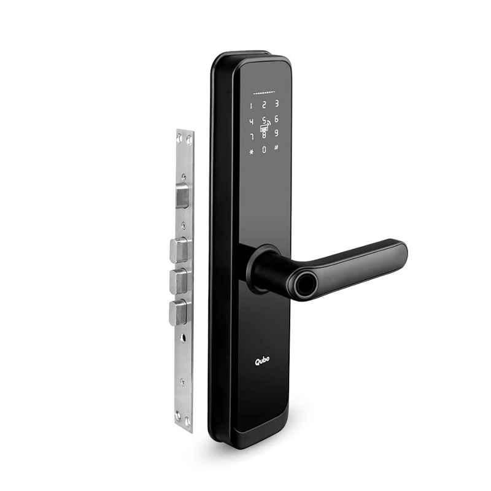

# Home Assistant Qubo Integration (Video Doorbell Pro & Smart Lock)

An unofficial Home Assistant custom integration providing cloud-based live RTSPS streaming, instant snapshot preloading, and smart lock control for select Qubo smart home hardware.

---

## Supported Devices (Tested & Verified)

<p align="center">
  
  &nbsp;&nbsp;&nbsp;&nbsp;&nbsp;&nbsp;&nbsp;&nbsp;
  
</p>

This integration has been developed and tested specifically with the following two hardware models:

| Device Name | Model Identifier | Type Identifier | Features Supported |
| :--- | :--- | :--- | :--- |
| **Qubo Smart Wi-Fi Video Doorbell Pro** | `HCD04C` | `videoDoorbellPro` | RTSPS Live Video Stream, Sub-10ms Snapshot Preload, Ring Sensor, Motion Detection |
| **Qubo Smart Door Lock Elite** | `HLM04` | `smartDoorLockElite` | Remote Unlock Actuation, Auto-Relock State Tracking, Door Contact Sensor, Battery Level |

> **Note:** Other Qubo models (such as indoor cameras or other lock variants) may work partially if they share the same cloud APIs, but only the two models above have been actively verified.

---

## Key Features

- **Live RTSPS Video Feed:** Dynamically requests secure streaming sessions from Qubo's cloud stream manager to supply video feeds directly to Home Assistant and Apple HomeKit.
- **Fast Snapshot Preload:** Caches high-resolution visitor snapshots in memory and local storage to deliver sub-10ms response times for instant card previews in Home Assistant dashboards and Apple Home.
- **Doorbell Ring & Motion Sensing:** Real-time push notification listeners for doorbell button presses and motion detection events.
- **Smart Door Lock Control:** Actuates door unlock commands routed through the paired in-home gateway with optimistic UI state updates and automatic mechanical re-lock tracking (7-second timer).
- **Apple HomeKit Compatibility:** Compatible with HomeKit Bridge and standalone accessory exposure.

---

## Architecture & Technical Disclosures

1. **Continuous Internet Required:** Qubo devices do not provide local network RTSP streams or local HTTP APIs. Video streams and commands are routed via Qubo cloud infrastructure. An active internet connection is required at all times.
2. **Direct Authentication:** Credentials entered during configuration are transmitted directly from your Home Assistant host to Qubo authentication endpoints using TLS. Credentials and tokens are stored solely in Home Assistant's internal encrypted configuration storage.
3. **Account Sessions:** Qubo limits concurrent active login sessions per account. It is recommended to use an account dedicated to Home Assistant or maintain consistent session tokens.

---

## Installation

### Method 1: HACS (Recommended)

1. Open **HACS** in your Home Assistant instance.
2. Click the top-right three dots menu and select **Custom repositories**.
3. Add the URL of your repository:
   - **Repository:** `https://github.com/akarshpatil/ha-qubo-doorbell`
   - **Category:** `Integration`
4. Click **Add**, locate **Qubo (Video Doorbell & Smart Lock)**, and click **Download**.
5. Restart Home Assistant.

### Method 2: Manual Installation

1. Copy the `custom_components/qubo_doorbell` folder into your Home Assistant `/config/custom_components/` directory:
   ```bash
   cp -r custom_components/qubo_doorbell /path/to/homeassistant/config/custom_components/
   ```
2. Restart Home Assistant.

---

## Configuration

1. In Home Assistant, navigate to **Settings** -> **Devices & Services**.
2. Click **Add Integration** and search for **Qubo**.
3. Enter your Qubo account email address and password.
4. Once authenticated, your discovered Doorbell and Smart Lock entities will appear under the integration card.

---

## Entity Overview

### Video Doorbell Pro
- `camera.<name>_live_feed`: Live RTSPS camera feed with fast snapshot proxy.
- `binary_sensor.<name>_ring`: Turns `on` when the doorbell button is pressed.
- `binary_sensor.<name>_motion`: Turns `on` when motion or person activity is detected.
- `image.<name>_last_visitor`: Latest visitor snapshot captured at the entrance.
- `sensor.<name>_last_event`: Event log and timestamps for doorbell activity.

### Smart Door Lock Elite
- `lock.<name>`: Door lock control entity supporting `unlock` actuation and auto-relock status.
- `binary_sensor.<name>_door`: Door open/closed contact state.
- `sensor.<name>_battery`: Battery level percentage reported by the lock hardware.
- `sensor.<name>_last_event`: Door unlock event history.

---

## Troubleshooting

- **Live Stream Loading:** If the live stream takes several seconds to initiate, ensure Home Assistant has outbound internet connectivity to reach Qubo streaming servers.
- **Door Lock Response:** Ensure the Video Doorbell Pro or designated in-home gateway is powered and online, as lock commands are transmitted via Bluetooth from the gateway to the lock.

---

## Disclaimer

This project is an independent community development and is not affiliated with, authorized, maintained, or endorsed by Hero Electronix or Qubo. All product names, logos, and brands are property of their respective owners.
