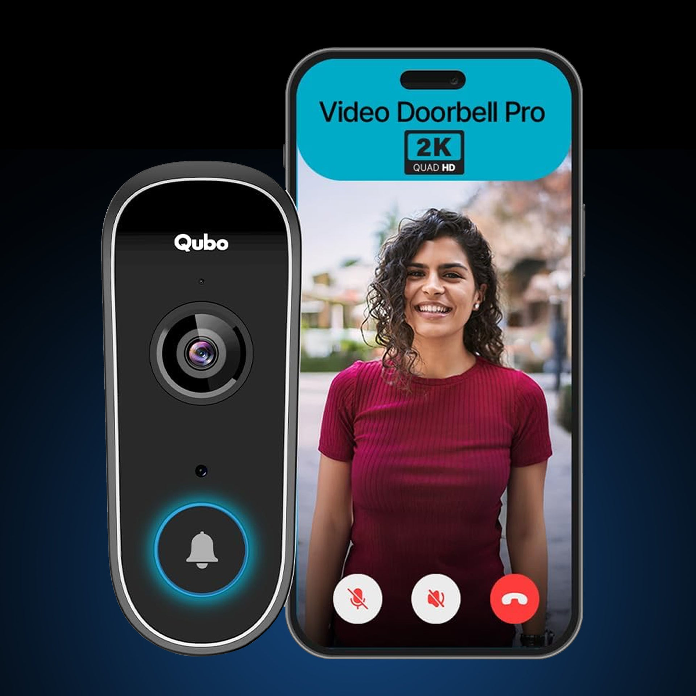

# Home Assistant Qubo Integration (Video Doorbell Pro & Smart Lock)

An unofficial Home Assistant custom integration providing **direct local LAN P2P UDP video streaming with sub-second latency**, cloud fallback, instant snapshot preloading, native Apple HomeKit Video Doorbell support, and smart lock control for Qubo smart home hardware.

<p align="center">
  <a href="https://my.home-assistant.io/redirect/hacs_repository/?owner=Akarshpatil&repository=ha-qubo-doorbell&category=integration">
    
  </a>
</p>

---

## Supported Devices (Tested & Verified)

<p align="center">
  
  &nbsp;&nbsp;&nbsp;&nbsp;&nbsp;&nbsp;&nbsp;&nbsp;
  
</p>

| Device Name | Model Identifier | Type Identifier | Features Supported |
| :--- | :--- | :--- | :--- |
| **Qubo Smart Wi-Fi Video Doorbell Pro** | `HCD04C` | `videoDoorbellPro` | **Direct LAN P2P UDP Live Stream (<500ms latency)**, Cloud RTSPS Fallback, Sub-10ms Snapshot Preload, Ring Sensor, Motion Detection, Native HomeKit Doorbell (Category 18) |
| **Qubo Smart Door Lock Elite** | `HLM04` | `smartDoorLockElite` | Remote Unlock Actuation, Auto-Relock State Tracking, Door Contact Sensor, Battery Level |

---

## Key Features

- **🚀 Ultra-Low-Latency Local P2P Video Streaming:**
  - Streams directly over your local Wi-Fi / LAN using Qubo's reverse-engineered native P2P protocol (`p2pCall` + AES-128-GCM RTP + STUN/ICE nomination).
  - **Sub-second glass-to-glass latency (<500ms)** in Apple Home and Home Assistant.
  - **Zero viewer limits:** Bypasses cloud relay caps, allowing unlimited simultaneous streams via MediaMTX or go2rtc.
  - **Hardware session auto-teardown:** When all viewers disconnect, the camera encoder cleanly disengages, battery is conserved, and the camera's blue ring LED turns off.
- **🍎 Native Apple HomeKit Video Doorbell:**
  - Automatically configures HomeKit accessory category as `CATEGORY_VIDEO_DOOR_BELL` (18).
  - Enables native HomePod chime, rich visitor picture-in-picture alerts on Apple TV, and native smart lock pairing.
  - Uses native H.264 stream pass-through (`video_codec: copy`) for immediate playback with zero host CPU transcoding load.
- **⚡ Instant Snapshot Preloading:** Caches high-resolution visitor snapshots in memory and local storage to deliver sub-10ms response times for Home Assistant dashboards and Apple Home previews.
- **🔔 Doorbell Ring & Motion Sensing:** Real-time push notification listeners for doorbell button presses and motion detection events.
- **🔒 Smart Door Lock Control:** Actuates door unlock commands routed through the paired in-home gateway with responsive UI state updates and automatic mechanical re-lock tracking (15-second timer).

---

## Quick Setup: 100% Local P2P Streaming

The integration comes with an automatic P2P UDP bridge (`p2p_streamer.py`) that auto-discovers your Qubo credentials, camera device IDs, and local IP straight from Home Assistant.

To enable local low-latency streaming, pair it with **MediaMTX** (recommended) or **go2rtc**:

### Step 1: Install MediaMTX

Download and run [MediaMTX](https://github.com/bluenviron/mediamtx) on your host or in Docker.

In your `mediamtx.yml`, add the following path under `paths:`:

```yaml
paths:
  qubo_local:
    runOnDemand: python3 /config/custom_components/qubo_doorbell/p2p_streamer.py
    runOnDemandRestart: yes
    runOnDemandStartTimeout: 12s
    runOnDemandCloseAfter: 5s
```

> **Tip:** If running outside Docker, replace `python3` and `/config/...` with the absolute path to your Python binary and Home Assistant config directory.

### Step 2: That's It!

When you view the camera in Home Assistant or Apple Home:
1. MediaMTX runs `p2p_streamer.py` on-demand.
2. The script negotiates a local P2P session with the camera over UDP in ~300ms.
3. AES-128-GCM encrypted H.264 frames are decrypted in real-time and published to `rtsp://127.0.0.1:8554/qubo_local`.
4. When you close the stream, MediaMTX stops the streamer after 5 seconds, releasing the camera encoder and turning off the doorbell's blue LED ring.

If MediaMTX is not running, the integration automatically falls back to Qubo Cloud RTSPS streaming.

---

## Installation

### Method 1: HACS (Recommended)

[](https://my.home-assistant.io/redirect/hacs_repository/?owner=Akarshpatil&repository=ha-qubo-doorbell&category=integration)

1. Open **HACS** in your Home Assistant instance.
2. Click the top-right three dots menu and select **Custom repositories**.
3. Add the repository:
   - **Repository:** `https://github.com/akarshpatil/ha-qubo-doorbell`
   - **Category:** `Integration`
4. Click **Add**, locate **Qubo (Video Doorbell & Smart Lock)**, and click **Download**.
5. Restart Home Assistant.

### Method 2: Manual Installation

1. Copy the `custom_components/qubo_doorbell` folder into your Home Assistant `/config/custom_components/` directory:
   ```bash
   cp -r custom_components/qubo_doorbell /path/to/homeassistant/config/custom_components/
   ```
2. Restart Home Assistant.

---

## Configuration

[](https://my.home-assistant.io/redirect/config_flow_start/?domain=qubo_doorbell)

1. In Home Assistant, navigate to **Settings** -> **Devices & Services**.
2. Click **Add Integration** and search for **Qubo**.
3. Enter your Qubo account email address and password.
4. Your Doorbell and Smart Lock entities will be discovered and added automatically.

---

## Apple HomeKit Setup

To add the doorbell to Apple Home as a native Video Doorbell:

1. In Home Assistant, go to **Settings** -> **Devices & Services** -> **HomeKit Bridge**.
2. Add a new HomeKit Bridge entry or accessory inclusion for `camera.<name>_live_feed`.
3. In Apple Home on your iPhone or iPad, scan the pairing QR code.
4. The integration automatically sets the accessory category to **Video Doorbell** and configures low-latency streaming parameters.

---

## Entity Overview

### Video Doorbell Pro
- `camera.<name>_live_feed`: Live camera feed (Local P2P with Cloud RTSPS fallback).
- `binary_sensor.<name>_ring`: Turns `on` when the doorbell button is pressed.
- `binary_sensor.<name>_motion`: Turns `on` when motion or person activity is detected.
- `image.<name>_last_visitor`: Latest visitor snapshot captured at the entrance.
- `sensor.<name>_last_event`: Event log and timestamps for doorbell activity.

### Smart Door Lock Elite
- `lock.<name>`: Door lock control entity supporting `unlock` actuation and auto-relock status.
- `binary_sensor.<name>_door`: Door open/closed contact state.
- `sensor.<name>_battery`: Battery level percentage reported by the lock hardware.
- `sensor.<name>_last_event`: Door unlock event history.

---

## Standalone CLI Usage (Advanced)

`p2p_streamer.py` can also be run standalone outside Home Assistant for custom NVRs, Frigate, or testing:

```bash
python3 p2p_streamer.py \
  --email "your_qubo_email@example.com" \
  --password "your_qubo_password" \
  --rtsp-target "rtsp://127.0.0.1:8554/qubo_local"
```

All credentials, tokens, and camera UUIDs can also be auto-loaded directly from an existing Home Assistant installation by providing `--config-dir /path/to/ha/config`.

---

## Disclaimer

This project is an independent community development and is not affiliated with, authorized, maintained, or endorsed by Hero Electronix or Qubo. All product names, logos, and brands are property of their respective owners.
